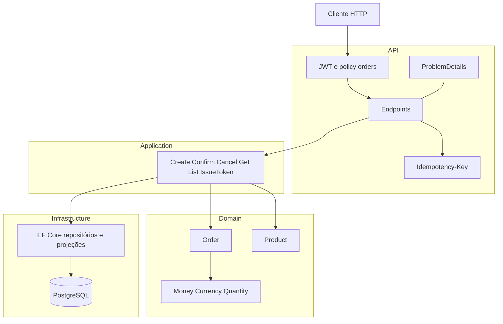

# Order Service

API de pedidos com itens, estoque e autenticação JWT. É a solução do teste técnico **Desenvolvedor(a) .NET Sênior** da nstech (Order Service), escrita para mostrar o tipo de decisão que se espera de uma pessoa em arquitetura: limites de módulo explícitos, invariantes no domínio e um caminho curto para rodar.

Stack: **.NET 10 / C# 14**, ASP.NET Core Minimal APIs, EF Core 10, PostgreSQL 17, FluentValidation, xUnit e Testcontainers.

## Visão geral

O serviço cria um pedido já no estado `Placed`, confirma reservando estoque e cancela devolvendo o estoque quando ele tinha sido reservado. Confirmar e cancelar são idempotentes. A listagem é paginada e filtrável. Toda mutação de pedido exige um JWT com o escopo `orders`.

O preço do item é um snapshot tirado do catálogo no momento da criação. O total é a soma de `preço unitário × quantidade`.

Quatro produtos já vêm semeados (moeda `BRL`):

| Produto | Id | SKU | Preço | Estoque inicial |
| --- | --- | --- | --- | --- |
| Notebook 14 polegadas | `11111111-1111-1111-1111-111111111111` | NB-14 | 4500.00 | 10 |
| Mouse sem fio | `22222222-2222-2222-2222-222222222222` | MOUSE-01 | 89.90 | 50 |
| Teclado mecânico | `33333333-3333-3333-3333-333333333333` | KB-MEC | 249.90 | 30 |
| Monitor 27 polegadas | `44444444-4444-4444-4444-444444444444` | MON-27 | 1299.00 | 15 |

## Arquitetura

Clean Architecture na solução e vertical slices dentro de `Application`. O domínio não conhece EF, HTTP nem JWT. Cada caso de uso (`CreateOrder`, `ConfirmOrder`, `CancelOrder`, `GetOrderById`, `ListOrders`, `IssueToken`) tem command, validator e handler na própria pasta. As razões e os trade-offs estão em [docs/decisions.md](docs/decisions.md).



## Checklist

- [x] API roda local e via Docker
- [x] Migrations aplicadas automaticamente no startup
- [x] Endpoints obrigatórios implementados
- [x] JWT e autorização básica nos pedidos (`scope=orders`)
- [x] `dotnet test` passando (domínio, aplicação e API com Postgres)
- [x] README com passo a passo

## Como rodar com Docker

Requisitos: Docker com Compose v2 e as portas `8080` e `5432` livres.

```bash
docker compose up --build
```

A API escuta em `http://localhost:8080`. O Postgres do compose usa usuário, senha e banco `orders` — **só para desenvolvimento**. A API espera o healthcheck do banco, aplica as migrations e semeia o catálogo. A connection string dentro do compose aponta para `host.docker.internal`: com a porta `5432` publicada, o Docker atual não entrega tráfego de um container direto no IP interno do banco, e o gateway do host mantém o mesmo acesso que o `dotnet run` local usa.

- Documentação interativa (Scalar, com esquema Bearer): `http://localhost:8080/scalar/v1`
- OpenAPI: `http://localhost:8080/openapi/v1.json`
- Liveness: `http://localhost:8080/health`
- Readiness (Postgres): `http://localhost:8080/health/ready`

Para encerrar e apagar o volume:

```bash
docker compose down -v
```

## Como rodar local

Requisitos: SDK .NET 10 e um Postgres acessível. O `global.json` pede a faixa 10.0 e aceita um SDK mais novo da mesma linha.

```bash
docker compose up -d db
dotnet restore OrderService.slnx
dotnet run --project src/OrderService.Api
```

A connection string padrão aponta para `localhost:5432` com o mesmo usuário do compose. Qualquer valor pode ser sobrescrito por variável de ambiente:

| Variável | Padrão de desenvolvimento |
| --- | --- |
| `ConnectionStrings__Orders` | `Host=localhost;Port=5432;Database=orders;Username=orders;Password=orders` |
| `Jwt__Issuer` / `Jwt__Audience` | `order-service` |
| `Jwt__SigningKey` | `dev-only-signing-key-change-me-32chars` |
| `Jwt__ExpirationMinutes` | `60` |
| `Auth__ClientId` | `dev-client` |
| `Auth__ClientSecret` | `dev-secret-change-me` |
| `Concurrency__MaxAttempts` | `3` |

Fora de `Development` e `Testing`, uma signing key que contenha `dev-only` impede a aplicação de subir. Não use esses valores em produção.

## Autenticação

```bash
curl -s -X POST http://localhost:8080/auth/token \
  -H 'Content-Type: application/json' \
  -d '{"clientId":"dev-client","clientSecret":"dev-secret-change-me"}'
```

Resposta:

```json
{
  "accessToken": "<jwt>",
  "tokenType": "Bearer",
  "expiresIn": 3600
}
```

Nos exemplos seguintes:

```bash
TOKEN=$(curl -s -X POST http://localhost:8080/auth/token \
  -H 'Content-Type: application/json' \
  -d '{"clientId":"dev-client","clientSecret":"dev-secret-change-me"}' \
  | python3 -c 'import json,sys; print(json.load(sys.stdin)["accessToken"])')
```

Sem token, ou com token sem o escopo `orders`, os endpoints de pedido respondem `401` com ProblemDetails.

## Endpoints

### Criar pedido

`POST /orders`

Não aceita pedido sem itens, quantidade menor ou igual a zero, produto inexistente, linha duplicada do mesmo produto, moeda diferente da do catálogo ou quantidade acima do estoque disponível. O pedido nasce `Placed` e **ainda não baixa o estoque**. O header `Idempotency-Key` é opcional: a mesma chave com o mesmo corpo devolve o pedido original; a mesma chave com outro corpo responde `409`.

```bash
curl -s -D - -X POST http://localhost:8080/orders \
  -H "Authorization: Bearer $TOKEN" \
  -H 'Content-Type: application/json' \
  -H 'Idempotency-Key: demo-pedido-1' \
  -d '{
    "customerId": "aaaaaaaa-aaaa-aaaa-aaaa-aaaaaaaaaaaa",
    "currency": "BRL",
    "items": [
      { "productId": "22222222-2222-2222-2222-222222222222", "quantity": 2 }
    ]
  }'
```

`201 Created`, com `Location: /orders/{id}` e total `179.80`.

### Confirmar pedido

`POST /orders/{id}/confirm`

Só confirma `Placed`. Baixa o estoque. Chamar de novo devolve o mesmo pedido confirmado e não baixa outra vez. Se o saldo mudou entre a criação e a confirmação, responde `409 insufficient_stock` e o pedido continua `Placed`.

```bash
curl -s -X POST http://localhost:8080/orders/$ORDER_ID/confirm \
  -H "Authorization: Bearer $TOKEN"
```

### Cancelar pedido

`POST /orders/{id}/cancel`

Aceita `Placed` e `Confirmed`. `Placed` não devolve estoque, porque nada foi reservado. `Confirmed` devolve a quantidade. Repetir o cancelamento devolve o pedido cancelado sem alterar o saldo de novo.

```bash
curl -s -X POST http://localhost:8080/orders/$ORDER_ID/cancel \
  -H "Authorization: Bearer $TOKEN"
```

### Consultar pedido

`GET /orders/{id}` devolve o pedido e os itens (preço, quantidade e total da linha).

```bash
curl -s http://localhost:8080/orders/$ORDER_ID \
  -H "Authorization: Bearer $TOKEN"
```

### Listar pedidos

`GET /orders?customerId=&status=&from=&to=&page=&pageSize=`

Paginação obrigatória: `page` padrão `1`, `pageSize` padrão `20`, máximo `100`. `from` e `to` são inclusivos sobre `createdAt` (ISO-8601). `status` aceita `Draft`, `Placed`, `Confirmed` ou `Canceled`.

```bash
curl -s "http://localhost:8080/orders?customerId=aaaaaaaa-aaaa-aaaa-aaaa-aaaaaaaaaaaa&status=Placed&page=1&pageSize=20" \
  -H "Authorization: Bearer $TOKEN"

curl -s "http://localhost:8080/orders?from=2026-01-01T00:00:00Z&to=2026-12-31T23:59:59Z&page=1&pageSize=10" \
  -H "Authorization: Bearer $TOKEN"
```

A resposta traz `items`, `page`, `pageSize`, `totalCount` e `totalPages`.

### Erros

Falhas de negócio saem como `application/problem+json`, com `errorCode` e `traceId`. Exemplos: `validation_error` (400), `product_not_found` (404), `insufficient_stock` e `invalid_transition` (409), `currency_mismatch` (422). O header `X-Correlation-Id` volta em toda resposta; se o cliente enviar um, ele é reaproveitado no log.

## Testes

```bash
dotnet test OrderService.slnx
```

- `OrderService.Domain.Tests`: invariantes do pedido, dinheiro, quantidade e estoque.
- `OrderService.Application.Tests`: orquestração dos casos de uso com fakes (reserva só na confirmação, liberação só no cancelamento de confirmado, retry de concorrência).
- `OrderService.Api.IntegrationTests`: sobe Postgres 17 via Testcontainers e exercita token, validação, paginação, idempotência e duas confirmações concorrentes disputando o mesmo saldo.

Se o Docker não estiver acessível (`docker info` falha), os testes de integração são ignorados com uma mensagem explícita. Os testes de domínio e de aplicação continuam rodando. Para regenerar a migration localmente: `dotnet tool restore` e `dotnet ef migrations add <Nome> --project src/OrderService.Infrastructure --startup-project src/OrderService.Api`.

## Layout

```
src/OrderService.Domain            agregados, value objects, erros
src/OrderService.Application       fatias por caso de uso e portas
src/OrderService.Infrastructure    EF Core, xmin, seed, idempotência
src/OrderService.Api               HTTP, JWT, OpenAPI, health
tests/                             domínio, aplicação e API
docs/decisions.md                  ADRs
```
